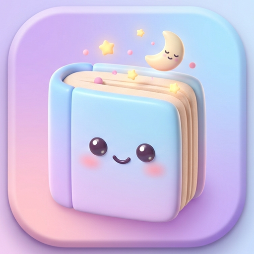

# HEQ KidsStory — حكايات النوم للأطفال

**حكايات نوم هادئة للأطفال من 3 إلى 8 سنوات**
**Calm bedtime stories for children aged 3–8**

العربية • English • Türkçe • Română • Deutsch

---

## 🌙 عن التطبيق

HEQ KidsStory مكتبة حكايات نوم هادئة بتصميم ليلي مريح للعين، صُنعت لتكون آمنة للأطفال وبلا إعلانات أو تتبّع:

- **سلسلة «فتيان حول الرسول ﷺ»**: سير الصحابة الصغار بأسلوب قصصي دافئ، **موثّقة المصادر** (مع رابط المصدر التاريخي لكل قصة).
- **بودكاست صوتي** بصوت الحكواتي الدافئ، مع **مؤقت نوم** يوقف الصوت تلقائياً.
- **لعبة تفاعلية لكل حكاية** يتعلّم فيها الطفل القيمة وهو يلعب.
- **استوديو الوالدين**: ينشئ الأب أو الأم قصة جديدة باسم الطفل (جزء أو جزآن أو ثلاثة)، يراجعها، ثم يحوّلها إلى حكاية صوتية.
- **رفيق البطل**: يصمّم الطفل شخصيته الخاصة (شكل، عيون، إكسسوارات، ألوان).
- **يعمل دون إنترنت**: احفظ الحكايات واستمع إليها في أي مكان.
- **5 لغات** مع واجهة كاملة من اليمين لليسار للعربية.

## 🌙 About

HEQ KidsStory is a calm, dark-themed bedtime library built to be safe for children — no ads, no tracking:

- **“Young Heroes Around the Prophet ﷺ”** — stories of the young Companions told warmly, **with sources** for every story.
- **Audio podcast** with a **sleep timer**.
- **An interactive game for every story.**
- **Parents’ studio** — parents create a new story with their child’s name (1, 2 or 3 parts), review it, then turn it into an audio story.
- **Hero companion** — children design their own character.
- **Works offline** — save stories and listen anywhere.
- **5 languages**, full right-to-left Arabic interface.

---

## 📲 التحميل • Download

| المنصة • Platform | الرابط • Link |
|---|---|
| 🌐 الويب • Web (PWA) | **[heq-kidsstory.netlify.app](https://heq-kidsstory.netlify.app)** |
| 🤖 Android (APK) | [Releases](../../releases) — _قريباً • coming soon_ |
| ▶️ Google Play | _قريباً • coming soon_ |

> على الويب: افتح الموقع ثم «إضافة إلى الشاشة الرئيسية» ليعمل كتطبيق.
> On the web: open the site and choose “Add to Home Screen” to install it as an app.

---

## 👶 الفئة العمرية • Audience

- مخصص للأطفال من **3 إلى 8 سنوات**، بإشراف الوالدين.
- إنشاء القصص بالذكاء الاصطناعي **للوالدين فقط** (18+) بعد تسجيل الدخول والموافقة.
- Designed for children **3–8** with parental guidance. AI story creation is **parents-only (18+)**.

## 🔒 الخصوصية • Privacy

- ❌ لا إعلانات • No ads
- ❌ لا تتبّع ولا أدوات تحليل • No tracking, no analytics
- 📱 بيانات الطفل على جهازه • Child data stays on the device
- 🤖 اسم الطفل **لا يُرسل أبداً** إلى الذكاء الاصطناعي • The child’s name is **never** sent to AI

📄 [سياسة الخصوصية الكاملة • Full Privacy Policy](PRIVACY.md) • 📄 [شروط الاستخدام • Terms](TERMS.md)

---

## 🆕 التحديثات • Updates

انظر [CHANGELOG.md](CHANGELOG.md) • See [CHANGELOG.md](CHANGELOG.md)

## ✉️ الدعم • Support

info@heqwerdk.com • [heqwerdk.com](https://heqwerdk.com)

---

جزء من عائلة تطبيقات **[HEQ](https://github.com/heqapps)** • Part of the **[HEQ](https://github.com/heqapps)** app family

[HEQ Werdk](https://heqwerdk.com) • [HEQ Link](https://play.google.com/store/apps/details?id=com.hothaifahajen.app) • [HEQ Run](https://github.com/HuzhaifaEqbal/HEQ-Run-Desktop)

© HEQ team. All rights reserved.

